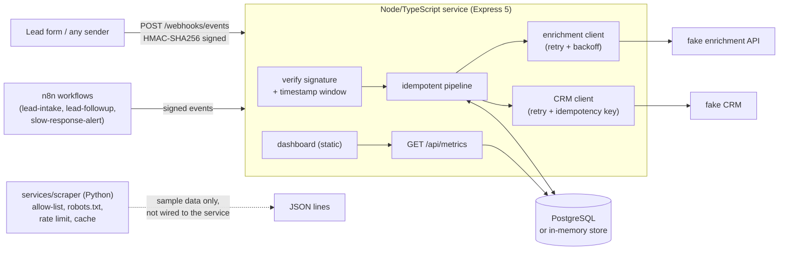
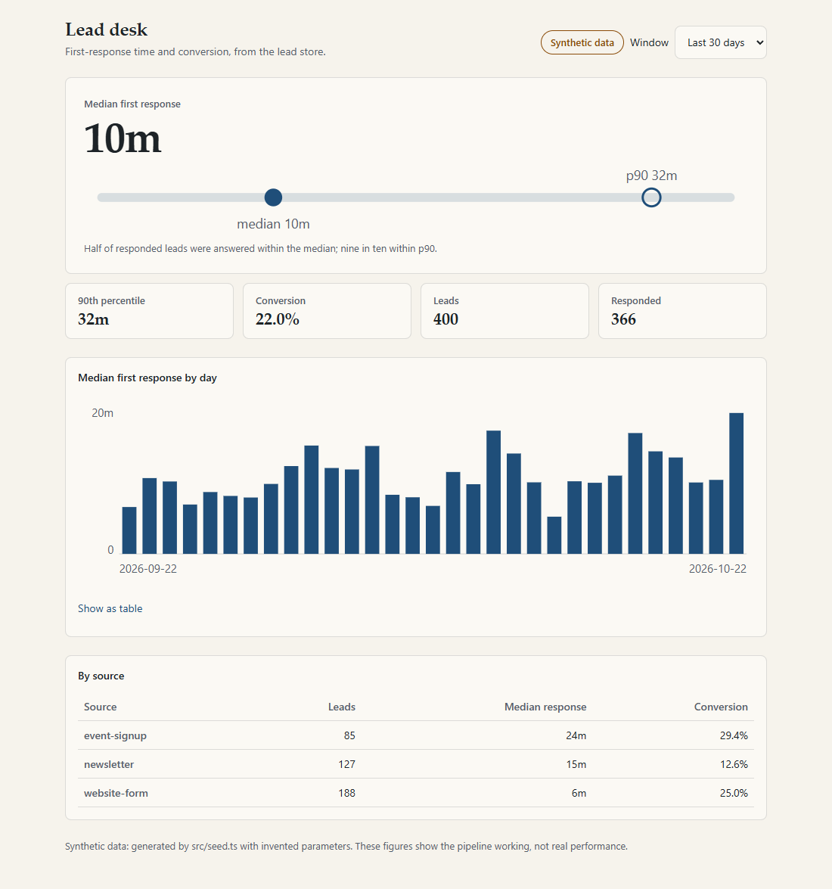

# lead-flow-automation

[](https://github.com/dc-tech-inc/lead-flow-automation/actions/workflows/ci.yml)
[](LICENSE)

A reference implementation of a **lead capture → automation → CRM** pipeline, by [DCtech.](https://dctech.live):
HMAC-signed webhooks into a Node/TypeScript service, versioned [n8n](https://n8n.io) workflows, resilient calls to
third-party APIs (a fake CRM and a fake enrichment API), a PostgreSQL store, an ethical Python scraper, and a
dashboard for **response time** and **conversion**.

> **All numbers in this repository are computed over synthetic data** generated by [`src/seed.ts`](src/seed.ts).
> They show that the pipeline measures things, not how any real business performs. The dashboard says so on screen.

## The problem it models

A lead arrives (web form, newsletter, event sign-up). Someone has to be told, the lead has to land in the CRM
exactly once even if the sender retries, and the team wants to know two things: *how fast do we answer?* and
*how many leads convert?* This repo implements that loop end to end with fake external systems, so you can
run it, break it, and read the code.

## Architecture



## Run it

You need Docker (Compose v2).

```bash
cp .env.example .env        # then set WEBHOOK_SECRET and N8N_ENCRYPTION_KEY to long random values
docker compose up --build
```

- Dashboard: <http://localhost:3000> (the database is seeded with 400 synthetic leads on first start; set `SEED_ON_START=false` to skip)
- n8n: <http://localhost:5678> (create the owner account on first visit)

Without Docker (Node 24 and pnpm; uses the in-memory store):

```bash
pnpm install
WEBHOOK_SECRET=change-me-to-a-long-random-string ENABLE_FAKES=true SEED_ON_START=true pnpm dev
```

Send a signed event yourself:

```bash
WEBHOOK_SECRET=change-me-to-a-long-random-string node scripts/smoke.mjs   # creates, answers and checks a lead
```

## The webhook contract

`POST /webhooks/events` with a JSON body, `X-Timestamp: <unix seconds>` and
`X-Signature: sha256=<hex>` where the signature is `HMAC_SHA256(secret, "<timestamp>.<raw body>")`.

| Event `type` | Fields | Effect |
|---|---|---|
| `lead.created` | `externalId`, `source`, `email`, `name`, optional `occurredAt` | stores the lead, enriches it (best effort), creates the CRM contact |
| `lead.responded` | `externalId`, optional `occurredAt` | records the **first** response time (later ones are ignored) |
| `lead.converted` | `externalId`, optional `occurredAt` | records the conversion once |

| Status | Meaning |
|---|---|
| 201 | lead created and synced to the CRM |
| 202 | lead stored, CRM sync failed after retries (`crm_status = failed`) |
| 200 | accepted; `duplicate: true` when it was a redelivery |
| 400 | body is not valid JSON or not a valid event |
| 401 | missing, malformed, stale (> 5 min) or wrong signature |
| 404 / 422 | unknown lead / event timestamp earlier than the lead |

Design notes: [ADR 0001](docs/adr/0001-signed-webhooks.md) (why this scheme, and what a replay inside the window can and cannot do).

## Dashboard



The screenshot is produced by a headless-browser test ([`test/e2e/dashboard.e2e.test.ts`](test/e2e/dashboard.e2e.test.ts)),
not mocked up. Definitions: *response time* = `responded_at - received_at` over leads that were answered;
*median* and *p90* use linear interpolation; *conversion* = converted leads / leads received in the window;
days are UTC. The synthetic parameters (response-time medians and conversion rates per source) are invented inputs
in `src/seed.ts`, so the differences between sources are an artefact of the generator.

## n8n workflows

Exported JSON in [`n8n/workflows/`](n8n/workflows):

| Workflow | Trigger | What it does |
|---|---|---|
| `lead-intake` | Webhook `POST /webhook/lead-form` | builds a `lead.created` event, signs it with the Crypto node (HMAC-SHA256), posts it to the service |
| `lead-followup` | Webhook `POST /webhook/lead-followup` | drafts a reply (sending is a deliberate stub: no mail server here) and posts a signed `lead.responded` |
| `slow-response-alert` | every 15 min | reads `/api/metrics?days=1` and branches when the median is above 15 minutes; the notification node is a placeholder |

To use them in the Compose stack: open n8n, add a **Crypto** credential named `lead-flow webhook secret` whose HMAC secret is the
same `WEBHOOK_SECRET` as the service, attach it to the two *Sign* nodes, then activate the workflows (imported workflows start inactive).
Secrets are never stored in the exports; they carry only a `CREATE_ME` credential placeholder.

**What is verified and what is not.** CI imports the exports into a real n8n container with `n8n import:workflow`
(see [n8n CLI docs](https://docs.n8n.io/hosting/cli-commands/)), a vitest suite checks their structure, and a contract test runs the intake
workflow's Code node and checks that the signature scheme it configures is accepted by the service. **n8n never executes a workflow in CI**; that is
tracked in [#4](https://github.com/dc-tech-inc/lead-flow-automation/issues/4).

## The scraper

[`services/scraper`](services/scraper) is a separate Python package that collects sample listing data from two scraping-practice sites,
`books.toscrape.com` and `quotes.toscrape.com`, and only those. It checks `robots.txt`, rate-limits, caches and identifies itself.
It is not connected to the lead service, because those sites contain no leads. See its [README](services/scraper/README.md) and [ADR 0003](docs/adr/0003-ethical-scraping-by-construction.md).

## Tests and CI

| Check | What it covers |
|---|---|
| `pnpm lint` / `typecheck` / `build` | ESLint + typescript-eslint, `tsc --strict`, compiled output |
| `pnpm test:coverage` | 77 Vitest tests (97% statements, 93% branches in CI, enforced floors at 85% lines and 75% branches), including an integration test of the PostgreSQL store against a real database in CI |
| `pnpm test:e2e` | headless Chromium loads the dashboard, checks the synthetic label and regenerates the screenshot |
| `pytest` (scraper) | 44 offline tests, 100% coverage, ruff lint and format |
| gitleaks | full-history secret scan; the binary is downloaded with its sha256 verified |
| n8n import | imports the three workflows into `n8nio/n8n` and lists them |
| Compose smoke test | `docker compose up`, then `scripts/smoke.mjs` signs, sends and verifies events, then n8n is booted with the imported workflows |

The heavy jobs run on pull requests and manual dispatch. Dependabot watches npm, pip, GitHub Actions and Docker.

## Limitations

- Fake CRM and enrichment, synthetic metrics, no real mail or notification sending. Swap `CRM_URL` / `ENRICH_URL` to point at real APIs of the same shape.
- Events are processed inline; a CRM that stays down leaves leads with `crm_status = failed` and nothing retries them yet ([#2](https://github.com/dc-tech-inc/lead-flow-automation/issues/2)).
- `/api/metrics` and the dashboard have no authentication; fine for demo data, not for real leads ([#3](https://github.com/dc-tech-inc/lead-flow-automation/issues/3)).
- Replays inside the 5-minute window are accepted by design; handlers are idempotent ([ADR 0001](docs/adr/0001-signed-webhooks.md)).
- No TLS termination or rate limiting on the webhook endpoint; put it behind a reverse proxy.
- The Compose stack was exercised in CI, not on the author's machine (no Docker there); the service, tests and scraper were also run locally.

## Roadmap

Tracked as issues: [#2](https://github.com/dc-tech-inc/lead-flow-automation/issues/2) an outbox + worker to retry failed CRM syncs,
[#3](https://github.com/dc-tech-inc/lead-flow-automation/issues/3) authentication for the metrics endpoint, and
[#4](https://github.com/dc-tech-inc/lead-flow-automation/issues/4) executing the n8n workflows end to end in CI.

## Sources consulted

- n8n: [CLI commands (`import:workflow`)](https://docs.n8n.io/hosting/cli-commands/), [Crypto node](https://docs.n8n.io/integrations/builtin/core-nodes/n8n-nodes-base.crypto/), [Webhook node](https://docs.n8n.io/integrations/builtin/core-nodes/n8n-nodes-base.webhook/)
- Node.js: [`crypto.createHmac` / `timingSafeEqual`](https://nodejs.org/api/crypto.html)
- Express 5: [`express.raw`](https://expressjs.com/en/5x/api.html#express.raw)
- [RFC 9309, Robots Exclusion Protocol](https://www.rfc-editor.org/rfc/rfc9309) (unavailable robots.txt handling, section 2.3.1; caching, section 2.4)
- Playwright: [`browserType.launch`](https://playwright.dev/docs/api/class-browsertype#browser-type-launch) (`channel`, headless default)
- Scraping practice sites: <https://quotes.toscrape.com>, <https://books.toscrape.com>

## License

[MIT](LICENSE) © 2026 DC TECH INC. See [CONTRIBUTING](CONTRIBUTING.md) and [SECURITY](SECURITY.md).
